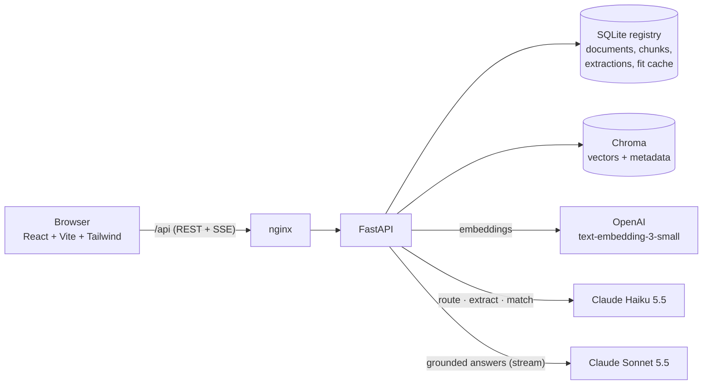

# RoleLens

*See your resume through the lens of any role.*

RoleLens is an application that helps users see how well their resume matches a job description.
Users upload their resume and job descriptions from different companies, and the Fit dashboard shows
a 0–100 score for how well each role matches the resume. Users see their resume through the lens of
each job description.

**Live app:** https://rolelens-demo.onrender.com (uploads enabled; shared workspace with temporary storage).

| Chat with citations | Fit dashboard | Prompt injection refused |
|---|---|---|
|  |  |  |

## What it does

- **Upload** one resume and any number of job descriptions (PDF, DOCX, TXT). Each is parsed, split
  into sections, given an auto-label like *Job #2 — Machine Learning Engineer, Lumen Labs*, and indexed.
- **Ask questions** ("What does Job #2 require that I'm missing?", "Which role fits me best?").
  Answers stream token by token and cite their sources as numbered pills that open the exact excerpt.
  When the documents don't contain the answer, it says so.
- **Fit dashboard:** per job, a 0–100 score, matched / partial / missing requirements ranked by
  prominence, the resume evidence behind every match, and a one-line verdict; plus a comparison of all roles.
- **Guardrails:** document text is treated as data, never instructions. Uploads containing
  instruction-like text are flagged, and off-topic questions are declined.

## Scope (contract for this build)

In scope: one resume, many job descriptions; grounded Q&A with citations; a per-job fit dashboard.

Out of scope (see [What's next](#whats-next)): user accounts and multi-tenancy, multiple resumes,
conversation memory, reranking / hybrid search, an async ingestion queue, resume rewriting, job scraping.

## Setup

Needs Docker (with Compose v2), an Anthropic API key and an OpenAI API key.

```bash
git clone https://github.com/anitakapal25/rolelens.git
cd rolelens
cp .env.example .env          # then set ANTHROPIC_API_KEY and OPENAI_API_KEY in .env
docker compose up --build
```

Open **http://localhost:8080**. API docs: http://localhost:8000/docs. The first build takes about a
minute. Data survives restarts (named volumes); `docker compose down -v` wipes it.

No files of your own? Upload the fictional samples in
[`backend/app/eval/sample_docs/`](backend/app/eval/sample_docs/): one resume and three job
descriptions. The Brightwave one contains a prompt-injection attempt.

### Local development

Needs Python 3.12 and Node 22.

```bash
python3.12 -m venv .venv && .venv/bin/pip install -r backend/requirements-dev.txt
(cd frontend && npm install)
make chroma      # vector DB in Docker on :8001
make backend     # API on :8000 (reload)
make frontend    # UI on :5173
make test        # 151 offline tests (LLM, embeddings and vector DB are faked)
make eval        # golden-set eval against the real models (~$0.15)
```

### Render (free hosting)

The app runs as **one** container ([`Dockerfile.render`](Dockerfile.render)): the API under `/api`,
the built frontend at `/`, and an in-memory vector store. Optional demo mode (`DEMO_MODE=true`) loads
a pre-processed snapshot of
the sample documents ([`backend/app/demo/seed.json`](backend/app/demo/seed.json)), so it starts
with zero model calls. In demo mode, uploads are disabled.

Rate limits are on in the Render image (`RATE_LIMIT=true`), with or without demo mode: chat is limited
to 15 questions per IP per hour and 200 per day, uploads to 5 per IP per hour and 50 per day.

- **Render**: New → Blueprint → this repo ([`render.yaml`](render.yaml)) → enter the two keys.
  The current service has `DEMO_MODE=false` to enable uploads. Data is lost when the free service
  sleeps or restarts, and all visitors share the same workspace.

## Architecture



**Upload path:** parse (PyMuPDF / python-docx) → detect sections → chunk (one chunk per job/project
entry; long sections split on bullet boundaries with overlap) → one Haiku structured-extraction call
(skills, years, evidence) → embed chunks with a context header → write SQLite, then Chroma. Model
calls happen before any write, so a failed upload leaves nothing half-indexed.

**Question path:** route the question to documents (keyword rules for explicit references like
"Job #2", Haiku when unsure, all documents if the router fails) → search each routed document
separately with a metadata filter (top-k per job description; a small resume is included whole) →
build a prompt of numbered, labelled, escaped chunks → stream Sonnet's answer over SSE → send the
cited chunk numbers with the final event.

**Fit path:** Haiku judges match / partial / missing for each job requirement against the resume's
skills (cached per job and resume pair) → plain Python computes the weighted score, verdict and ranking.

Code map: `backend/app/{api, ingest, retrieval, llm, chat, fit, eval, demo}`, `frontend/src/{components, lib}`.
Every decision is logged in [`docs/decisions.md`](docs/decisions.md).

## RAG / LLM decisions

| Area | Considered | Picked | Gave up |
|---|---|---|---|
| LLM | One model for everything; GPT | **Claude Sonnet 5.5** for answers, **Haiku 5.5** for routing, extraction and matching | Single-vendor simplicity (embeddings are OpenAI) |
| Embeddings | Sentence-transformers locally; Voyage | **OpenAI `text-embedding-3-small`** (1536-d) | A second API key and vendor |
| Vector DB | pgvector, Pinecone, in-memory | **Chroma** (Docker, cosine, metadata filters); in-memory for the free demo | Managed scaling; SQL joins with the registry |
| Orchestration | LangChain, LlamaIndex | **Hand-rolled** (~200 lines: router, per-document search, one prompt builder) | Ready-made integrations; more code to own |
| Structured output | "Reply in JSON" + parsing | **Claude structured outputs** into Pydantic models | Nothing significant |

### Why retrieval at all?

The sample documents are only about 4k tokens, so all of them could be pasted into every prompt, but
retrieval is still worth it for two reasons:

1. **Scale:** when a user uploads 20 job descriptions or a long CV, sending everything means big,
   slow, costly prompts where the model loses focus. Retrieval keeps prompts at 1.4k–4k tokens no
   matter how many documents there are, and no redesign is required.
2. **Citations:** retrieval controls which documents the model sees and makes citations precise.

## Key technical decisions

**Section-aware chunking.** Headers are matched against per-document-type synonym tables
("Technical Skills", "AI PROJECTS", "Roles & Responsibilities", "Required Skills"), so "Skills" means
the candidate's skills in a resume and the employer's requirements in a JD. Each job and project
becomes its own chunk, tagged with company and role; oversized sections split on paragraph → bullet
→ line → sentence boundaries with ~200 characters of overlap. Chunk size (1,200 characters) was
chosen from the data: real resume entries are 300–600 characters.

**Document-filtered retrieval.** Every chunk carries `doc_id`, `doc_type`, `section`, `company`,
`role` and `entry`. Questions are routed first, then each routed document is searched separately,
so a long JD can't crowd out the resume. A distance cut-off drops weak matches but always keeps the
best chunk of every routed document.

**Structured extraction alongside RAG.** Chat uses retrieval over chunks; the dashboard uses one
cached extraction per document and one cached matching call per (job, resume) pair. The model makes
small, evidence-backed judgments (referencing skills by number, never free text), and code does all
the arithmetic: weight = core 3 / supporting 2 / minor 1, halved for preferred; credit = 1 / 0.5 / 0.
Years of experience are computed in code from the dated roles, not by the model.

### Why these choices

Section-aware chunking is the better choice because documents like JDs and resumes have structure
(headings and bullets). Using that structure gives chunks that are each about one thing, which makes
retrieval precise.

## Evaluation

`make eval` runs a committed golden set on fictional documents (reproducible by anyone);
`make eval-private` runs a gitignored set on my real resume and job descriptions. Both ingest into
a throwaway registry and their own Chroma collection, call the real models, and grade deterministically:
the exact routed documents, required facts (groups of alternatives), banned phrases, which documents
are cited, "not in your documents" / off-topic phrasing, and fit-score bands.

| Set | Cases | Result | Cost per run |
|---|---|---|---|
| Sample (committed): 16 Q&A incl. 3 "not in your resume", 2 prompt-injection, 2 off-topic + 3 fit bands | 19 | **16/16 Q&A, 3/3 fit** on the final run | ~$0.14 |
| Private (my documents): 14 Q&A + 3 fit bands | 17 | **14/14 Q&A, 3/3 fit** | ~$0.14 |

Sample-set history: **11/16 → 16/16 → 15/16 → 16/16**. Of the first five failures, two were my YAML
(an unquoted `Job #2` is cut at the `#` comment), two were grader phrase lists, and one was a real
retrieval bug (the current role was missing from context; fixed as described above). The 15/16 run
failed a grader on an answer that *quoted* the injected claim while refusing it. Fit scores also
vary between fresh matching runs (one sample job scored 54, 59 and 44), which is why fit checks are bands.
The latest report is in [`backend/app/eval/results/sample-latest.json`](backend/app/eval/results/sample-latest.json).

### What the eval missed

I asked "what is match score?" in chat, and it said my documents don't contain a match score, even
though the Fit dashboard shows one for every job. This happened because chat only sees the documents;
fit scores are computed separately and never reach the chat prompt. So 16/16 meant "passes the checks
I wrote", not "works the way a user expects".

Next: give chat the computed scores, and add an eval case that compares the answer with the
dashboard's score from the same run.

## Productionizing (on AWS)

For the demo I deployed on Render because it is free. For a real multi-user product I would move to
AWS. This is a plan only; no AWS infrastructure code is in the repo.

| Concern | Today | Production on AWS |
|---|---|---|
| Compute | One container / Compose on one host | **ECS on Fargate** behind an **Application Load Balancer** (TLS via ACM), 2+ tasks across availability zones with autoscaling; the frontend as static files on **S3 + CloudFront** |
| Registry + vectors | SQLite + Chroma | **RDS for PostgreSQL** (or Aurora) with **pgvector**: one database for documents, chunks and vectors, `WHERE doc_id = …` filters in SQL, automated backups and point-in-time recovery |
| Original files | Not kept | **S3** bucket, encrypted with KMS, with a lifecycle (retention) policy |
| Ingestion | Synchronous in the request | Upload goes to S3 and returns `202`; an **SQS** queue feeds a worker (ECS task) that parses, extracts and embeds; the UI polls or streams progress |
| Auth + tenancy | None, one shared workspace | **Amazon Cognito** issuing JWTs verified in a FastAPI dependency; `tenant_id` on every row and vector, enforced with Postgres row-level security |
| LLM + embeddings | Anthropic and OpenAI APIs | Claude through **Amazon Bedrock** (data stays in the AWS account and region, IAM instead of API keys); embeddings via Bedrock or the OpenAI API |
| Secrets | `.env` | **Secrets Manager**, injected into tasks by IAM role; separate keys for staging and production |
| Rate limits + caching | In-memory, per process | **AWS WAF** rate rules at the edge; per-user quotas and shared counters in **ElastiCache (Redis)**; cache question embeddings and fit results |
| Observability | JSON logs, `/metrics`, `/health` | **CloudWatch** logs, metrics and alarms (error rate, latency, daily LLM cost); **OpenTelemetry → X-Ray** traces with LLM spans |
| CI/CD | GitHub Actions (tests, build, Docker) | GitHub Actions with OIDC → push images to **ECR** → deploy to ECS (staging, then production); nightly `make eval` that fails on a pass-rate drop |
| Infrastructure | Compose file | Terraform or AWS CDK, one stack per environment |
| Cost controls | Rate limits + provider spend caps | Per-tenant token budgets, prompt caching for static system prompts, Haiku for cheap steps, `max_tokens` caps, **AWS Budgets** alerts |
| Privacy | One shared workspace | Encryption at rest (RDS, S3 with KMS), a delete-my-data endpoint, data-retention limits, private subnets for the database |

## Standards followed and skipped

**Followed**
- Layered backend (`api` → `ingest` / `retrieval` / `llm` / `fit`); route handlers hold no business logic.
- Type hints everywhere; Pydantic at every boundary (HTTP, LLM output, eval files, demo seed).
- All prompts in one file; document text delimited and escaped in every prompt.
- 151 offline tests (LLM, embeddings and vector DB faked through protocols); CI on every push; a golden-set eval for behaviour.
- Structured JSON logs with request ids, `/health` with dependency checks, `/metrics`.
- Atomic ingestion, a versioned match cache, an additive schema migration, a non-root container user, secrets only in env.
- A decision log kept during the build ([`docs/decisions.md`](docs/decisions.md)) and small commits.

**Skipped (deliberately, for a one-day build)**
- No authentication, no multi-tenancy; one shared workspace.
- Rate limiting in memory, per process (right for one instance; Redis or WAF with several).
- SQLite registry: one backend instance only.
- No frontend unit tests (the UI was checked with scripted browser runs).
- No reranking or hybrid keyword search; no conversation memory.
- No LLM tracing tool (Langfuse); JSON logs carry the same fields.
- Backend image is 770 MB (PyMuPDF and Chroma client dependencies).

## AI tool usage

Built with Claude Code. [`CLAUDE.md`](CLAUDE.md) is the rules file every session starts from: fixed
stack (no LangChain), layer boundaries, Pydantic at boundaries, **no new dependency without asking**,
tests for every pure function in `ingest/` and `retrieval/`, all prompts in `llm/prompts.py`, and
eval rules (run `make eval` after prompt or retrieval changes; read failing answers before calling
them app bugs). The "AI workflow" section of [`docs/decisions.md`](docs/decisions.md) records how it was used.

### Do's and don'ts

- I wrote the CLAUDE.md file, which defines everything the assistant needs to remember in every
  session: stack, format, style and dependencies.
- The assistant wrote most of the code, including the core logic (answer prompt, router,
  per-document search).
- Before installing any dependency, the assistant asks for my approval.

## What's next

- **LLM judge** for faithfulness and prompt-injection eval cases (the substring graders' known blind spot); a larger golden set built from real questions.
- **Stabler fit scores:** majority vote over three matching calls, or a fixed skill taxonomy; score soft skills separately.
- **Hybrid search + reranking** for long or many job descriptions.
- **Conversation memory** for follow-ups ("and what about Job #1?").
- **Accounts and multi-tenancy** (see Productionizing), then multiple resume versions.
- **Async ingestion** with progress events instead of a 5–25 s request.
- **Frontend tests** (SSE parser, citation rendering) and a smaller backend image.
- **Resume rewriting suggestions** per job, grounded in the gap list.
